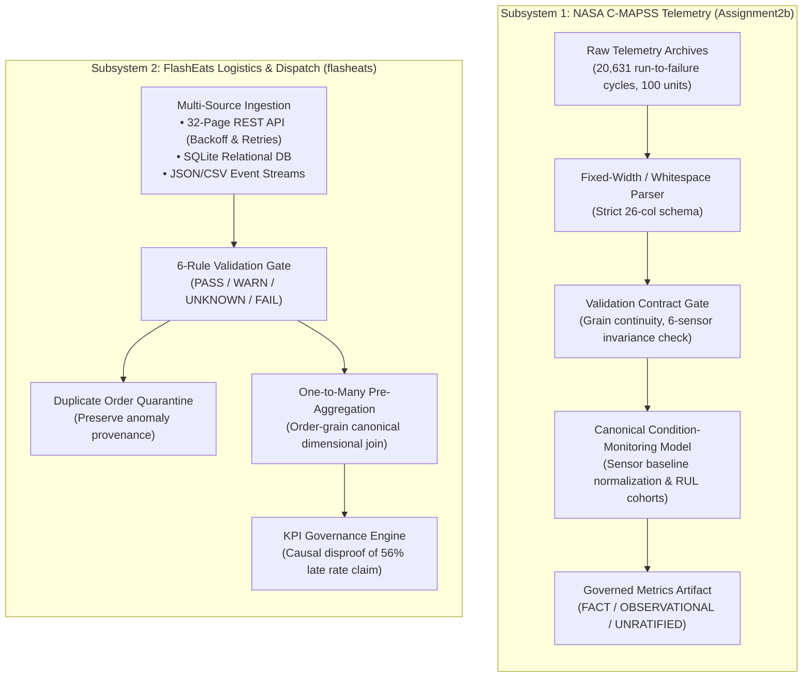

# Forward-Deployed Engineering (FDE) Data Foundations & Operational Telemetry

[](https://github.com/NEERASA-VEDA-VARSHIT/FDE_Assigment2/actions/workflows/ci.yml)
[](https://www.python.org/)
[](https://github.com/astral-sh/ruff)
[](tests/)

A dual forward-deployed data engineering suite demonstrating resilient data ingestion, automated validation contracts, idempotent transformations, and metric governance across two operational data domains:
1. **Industrial Telemetry Dataset & Degradation** (`Assignment2b/`): NASA C-MAPSS turbofan gas-turbine sensor stream processing.
2. **On-Demand Dispatch & Logistics Event ETL** (`flasheats/`): Multi-source food delivery dispatch, ETA reliability, and executive KPI governance.

---

## Architecture Overview



---

## Subsystem 1: Industrial Telemetry Dataset (NASA C-MAPSS FD001)

Located in [`Assignment2b/`](Assignment2b/).

### Problem & Ingestion Engineering
Condition-based maintenance and predictive degradation models depend on clean telemetry. Sub-dataset FD001 captures 100 turbofan engines run to failure under sea-level static/cruise conditions ($90,000\text{ lb}$ thrust class).
* **Whitespace & Invariant Handling:** Ingests 20,631 cycle records across 26 columns without regex fragmentation.
* **Sensor Variance Auditing:** Gating detects that **6 of 21 gas-path instrumentation sensors** (`sensor_1`, `sensor_5`, `sensor_10`, `sensor_16`, `sensor_18`, `sensor_19`) exhibit zero variance ($\sigma = 0$) due to nominal sea-level cruise boundary constraints. Flags invariant channels before model ingestion.
* **Grain & Sequence Continuity:** Enforces 100% contiguity ($1..100$) and 0 missing cycle gaps across all 100 engines.

### Pipeline Execution & Artifacts
```bash
python Assignment2b/pipeline/run_pipeline.py
```
* **Execution Time:** ~0.44s
* **Outputs Generated:**
  * `Assignment2b/outputs/validation_report.json`: Schema verification, sensor variance audit, and lifecycle bounds.
  * `Assignment2b/outputs/final_output.csv`: Canonical grain-verified condition-monitoring dataset ($20,631 \times 32$).
  * `Assignment2b/outputs/metrics.csv`: Governed operational metrics (`FACT`, `OBSERVATIONAL`, `UNRATIFIED`).

---

## Subsystem 2: Dispatch Logistics & KPI Governance (FlashEats)

Located in [`flasheats/`](flasheats/).

### Resilient Multi-Source ETL
* **Paginated REST Dispatch API:** Ingests 32 pages (1,600 dispatch events) via mock API server with automated exponential backoff on HTTP 429 (rate limits) and retry logic on transient HTTP 500 errors.
* **Relational SQLite DB:** Extracts `orders`, `customers`, `drivers`, `restaurants`.
* **Telemetry & Action Feeds:** Semi-structured driver GPS JSON logs, merchant kitchen status CSVs, customer in-app action events, support tickets, and operational interventions.

### Validation Contracts & Metric Governance
* **Duplicate Quarantine:** Flags 3 duplicate order records into quarantine, retaining raw anomaly provenance rather than silently dropping rows.
* **Denominator Sensitivity & Causal Disproof:** Executive leadership cited an unratified claim that *"Late Delivery Rate is 56%"*. The pipeline proves that 56% is an artifact of unratified filtering:
  * Zero-tolerance delivered (`delay > 0 min` on non-null timestamps): **56.39%** (843 / 1,495)
  * All delivered orders (including 37 missing delivery timestamps): **55.03%** (843 / 1,532)
  * Total placed orders (including 68 cancellations): **52.69%** (843 / 1,600)
  * Meaningful friction buffer (`delay > 10 min`): **23.34%** (349 / 1,495)
* **Status:** `UNRATIFIED` — Publication is blocked until executive ownership consensus is ratified.

### Pipeline Execution & Artifacts
```bash
python flasheats/pipeline/run_pipeline.py
```
* **Execution Time:** ~2.35s (including multi-page API ingestion with rate-limit handling)
* **Outputs Generated:**
  * `flasheats/outputs/validation_report.json`: 6-rule validation results, freshness audit, and publish gate verdict.
  * `flasheats/outputs/final_output.csv`: Canonical order-grain dimensional dataset ($1,600 \times 24$).
  * `flasheats/outputs/metrics.csv`: Metric taxonomy breakdown with formal formulas and ratifications.

---

## Metric Governance Taxonomy

Both pipelines implement a strict three-tier FDE metric governance classification:

| Governance Status | Definition | Example Metric |
|---|---|---|
| **`FACT`** | Invariant mathematical or empirical truths derived from verified schema properties. | `trajectory_completeness_rate` (100%), `non_constant_sensor_ratio` (71.43%) |
| **`OBSERVATIONAL`** | Descriptive behavioral aggregates from observed data subject to population context. | `customer_friction_rate` (12.56%), `lifespan_coefficient_of_variation` (22.46%) |
| **`UNRATIFIED`** | Metric definitions lacking formal stakeholder ownership, disputed denominators, or unverified causality. | `late_delivery_rate` (56.39%), `critical_lifecycle_exposure` (15.03%) |

---

## Testing & CI/CD

Both pipelines feature automated unit test suites enforcing contract validation, grain invariance, idempotent hashing, and metric bounds.

```bash
# Install dependencies
pip install -r requirements.txt

# Run all 10 tests across both pipelines
pytest

# Run lint and format checks
ruff check Assignment2b/pipeline Assignment2b/tests flasheats/pipeline flasheats/tests
ruff format --check Assignment2b/pipeline Assignment2b/tests flasheats/pipeline flasheats/tests
```

### Test Suite Summary (`10/10` Passing)
* **NASA C-MAPSS (`Assignment2b/tests/test_pipeline.py`):**
  1. `test_01_ingestion_integrity_and_whitespace_parsing`: 20,631 rows, strict 26-column schema.
  2. `test_02_validation_gate_and_failure_contracts`: Detects 6 flatline sensors, validates 100/100 unit contiguity.
  3. `test_03_grain_invariants_and_fanout_prevention`: Enforces `(unit_number, time_in_cycles)` uniqueness.
  4. `test_04_metrics_governance_and_bounds`: Validates FACT/OBSERVATIONAL/UNRATIFIED metric contracts.
  5. `test_05_clean_room_idempotence`: Verifies bitwise SHA-256 reproducibility across successive runs.
* **FlashEats Logistics (`flasheats/tests/test_pipeline.py`):**
  1. `test_01_ingestion_integrity`: Validates API pagination completeness and SQLite schema contracts.
  2. `test_02_validation_gate_detects_anomalies`: Identifies duplicate orders, null delivery timestamps, and chronology inversions.
  3. `test_03_transformation_order_grain`: Enforces 1,600 unique `order_id` grain with zero fanout.
  4. `test_04_metrics_governance_and_computation`: Verifies candidate late delivery denominators and intervention rates.
  5. `test_05_clean_room_idempotence`: Verifies bitwise SHA-256 reproducibility across successive runs.

---

## Repository Structure

```text
.
├── .github/
│   └── workflows/
│       └── ci.yml               # GitHub Actions CI matrix (Python 3.10, 3.11, 3.12)
├── Assignment2b/                # Subsystem 1: Industrial Telemetry Dataset (NASA C-MAPSS)
│   ├── data/raw/CMAPSSData/     # Preserved raw NASA run-to-failure archives
│   ├── docs/                    # Source mapping, validation reports, workflow models
│   ├── outputs/                 # Deterministic output artifacts (CSV, JSON, log)
│   ├── pipeline/                # Modular ETL: config, ingest, validate, transform, metrics
│   └── tests/                   # Automated pytest validation suite
├── flasheats/                   # Subsystem 2: Dispatch Logistics ETL (FlashEats)
│   ├── data/                    # Relational DB, mock API data, JSON/CSV feeds
│   ├── docs/                    # Architecture decisions, KPI audit, validation specifications
│   ├── outputs/                 # Deterministic output artifacts (CSV, JSON, log)
│   ├── pipeline/                # Modular ETL: config, ingest, validate, transform, metrics
│   └── tests/                   # Automated pytest validation suite
├── pyproject.toml               # Unified project metadata, Ruff config & Pytest options
├── requirements.txt             # Locked core and development dependencies
└── README.md                    # Root architecture and engineering documentation
```
