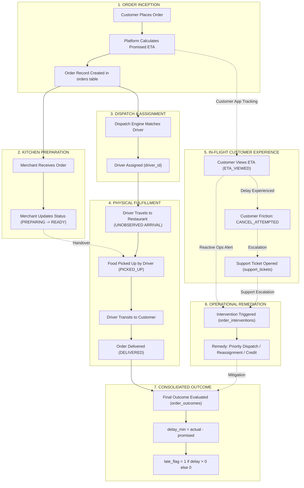

# FlashEats Business Workflow & Relational Model (Class 7 & Assessment 2)

## Executive Summary
In logistics and on-demand delivery, data systems are typically fragmented across disparate operational microservices: ordering engines, dispatch matchers, customer app telemetry, support ticketing, merchant kitchen apps, and financial billing.

Treating these data sources as flat, independent tables and joining them directly creates catastrophic **Cartesian join fanouts** (row multiplication), distorting financial and operational reporting. 

The **FlashEats Workflow Model** reorganizes raw sources around the natural business lifecycle:
$$\text{Order Placement} \longrightarrow \text{Kitchen Prep} \longrightarrow \text{Driver Assignment} \longrightarrow \text{Pickup} \longrightarrow \text{Delivery} \longrightarrow \text{Customer Interaction} \longrightarrow \text{Intervention} \longrightarrow \text{Outcome}$$

---

## 1. End-to-End Business Lifecycle Diagram



---

## 2. Canonical Relational Architecture

To eliminate row multiplication while maintaining complete analytical granularity, the architecture defines strict primary keys, foreign keys, and business grains:

| Entity Table | Primary Key | Foreign Keys | Business Grain | Operational Role |
|---|---|---|---|---|
| **`customers`** | `customer_id` | - | 1 row per customer | Customer master registry, contact profile, and geographic location. |
| **`restaurants`** | `restaurant_id` | - | 1 row per restaurant partner | Merchant profile, cuisine category, coordinates, and manual status flag. |
| **`drivers`** | `driver_id` | - | 1 row per courier | Courier fleet registry, vehicle type, rating, and tenure. |
| **`orders`** | `order_id` | `customer_id`, `restaurant_id`, `driver_id` | 1 row per order attempt | Core transactional entity holding baseline ETA, physical timestamps, and routing context. |
| **`customer_app_actions`** | `action_id` | `order_id`, `customer_id` | 1 row per customer mobile action | Pre-delivery interaction stream tracking customer app engagement, anxiety loops, and cancellation attempts. |
| **`support_tickets`** | `ticket_id` | `order_id` (nullable) | 1 row per customer complaint | CRM ticket records capturing qualitative feedback, friction categories, and customer messages. |
| **`order_interventions`** | `intervention_id` | `order_id` | 1 row per operational adjustment | Remedial actions applied by dispatchers or support agents to rescue at-risk orders. |
| **`order_outcomes`** | `order_id` | `order_id` | 1 row per completed order | Evaluated SLA fulfillment flags (`delivered_flag`, `late_flag`, `delay_min`, `outcome_bucket`). |

---

## 3. Order-Level Modeling & Aggregation Strategy

### The Cartesian Fanout Trap
Joining `customer_app_actions` (2,365 rows), `support_tickets` (202 rows), and `order_interventions` (430 rows) directly to `orders` (1,600 unique orders) results in an explosive Cartesian product:
$$\text{Row Count} = \sum_{\text{order}} \left( N_{\text{actions}} \times N_{\text{tickets}} \times N_{\text{interventions}} \right) \gg 1,600$$
Such row multiplication corrupts order counts, inflates financial metrics, and creates duplicate late flags.

### Pre-Aggregation Solution
The pipeline pre-aggregates every 1-to-many relationship to the `order_id` grain prior to merging:

```python
# 1. Customer actions pre-aggregated
actions_agg = customer_actions.groupby("order_id").agg(
    app_action_count=("action_id", "count"),
    cancel_attempted=("action_type", lambda s: int((s == "CANCEL_ATTEMPTED").any())),
    support_opened_app=("action_type", lambda s: int((s.isin(["SUPPORT_CONTACTED", "HELP_CLICKED"])).any()))
).reset_index()

# 2. Support tickets pre-aggregated
tickets_agg = valid_tickets.groupby("order_id").agg(
    support_ticket_count=("ticket_id", "count")
).reset_index()
tickets_agg["support_opened_ticket"] = 1

# 3. Interventions pre-aggregated
interventions_agg = interventions.groupby("order_id").agg(
    intervention_count=("intervention_id", "count"),
    intervention_types=("intervention_type", lambda s: "; ".join(sorted(s.unique())))
).reset_index()
```

### Verified Canonical Order-Level Schema (`final_output.csv`)
1. `order_id`: Unique order identifier (Primary Key, 0 duplicates).
2. `customer_id`: Registered customer identifier.
3. `support_opened`: Binary flag (1 if support was contacted via app or ticket; 0 otherwise).
4. `cancel_attempted`: Binary flag (1 if customer attempted cancellation; 0 otherwise).
5. `intervention_count`: Integer count of operational interventions applied (0 to $N$).
6. `intervention_types`: Semicolon-delimited list of unique intervention types applied.
7. `final_status`: Normalized operational status (`delivered` or `cancelled`).
8. `late_flag`: Evaluated outcome flag (1.0 = late, 0.0 = on-time, NaN = cancelled).
9. `delay_min`: Delivery latency in minutes (`actual_delivery_at - promised_eta`).

**Grain Verification**: The pipeline dynamically asserts grain invariants without hard-coding dataset size: `assert canonical_df["order_id"].is_unique` and `assert len(canonical_df) == orders["order_id"].nunique()` (empirically yielding 1,600 clean unique orders in today's dataset with zero duplicate rows).
